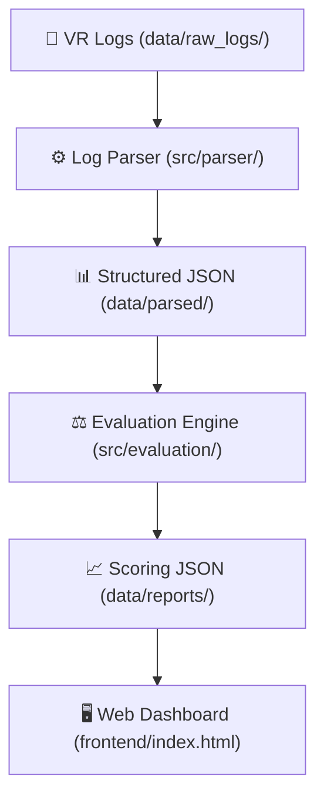

# 🏥 VR Medical Training Evaluation System

An automated evaluation system designed for medical VR training scenarios, focusing on the ABCDE emergency scheme for postoperative complications.

## 🏗️ System Architecture

This project is divided into three major components:

1. **Parser (Person A):** Converts raw `.txt` and `.docx` VR logs into structured JSON event timelines.
2. **Evaluation Engine (Person B):** Applies medical rubrics (ABCDE protocol + time constraints) to the structured timelines to generate scores and feedback.
3. **Web Dashboard (Person C):** A visual front-end that loads the Evaluation output and displays the finalized report to the medical instructor.



## 📂 Project Structure

```text
vr-training-evaluator/
├── README.md                 <-- System documentation
├── requirements.txt          <-- Python dependencies
├── run_pipeline.py           <-- One-click CLI & server runner
├── data/
│   ├── raw_logs/             <-- Put original VR logs (.txt, .docx) here
│   ├── parsed/               <-- Output from Parser goes here (.json)
│   └── reports/              <-- Output from Evaluation Engine goes here (.json)
├── docs/
│   └── scoring_weights.md    <-- Medical scoring rubric documentation
├── frontend/
│   ├── index.html            <-- Dashboard entry point
│   ├── styles.css            <-- UI styling
│   └── script.js             <-- UI logic & PDF report generator
└── src/
    ├── parser/
    │   ├── log_parser.py     <-- Parses txt files
    │   └── docx_parser.py    <-- Parses docx files + extracts expert comments
    ├── evaluation/
    │   ├── engine.py         <-- ABCDE clinical evaluation engine
    │   └── scoring.py        <-- Scoring weights, caps & limits
    └── validation/
        ├── sanity_check.py   <-- Validates against doctor annotations
        └── team_comparison.py <-- Compares results with other team
```

## ⚡ Quickstart (Deployable Package)

### 1. Install Dependencies
```bash
pip install -r requirements.txt
```

### 2. Run the Full Pipeline
Process all logs and generate complete evaluation reports:
```bash
python run_pipeline.py
```

### 3. Evaluate a Single Log File
```bash
python run_pipeline.py --file data/raw_logs/My_Session.docx
```

### 4. Launch the Dashboard
```bash
python run_pipeline.py --serve
```
This automatically opens `http://localhost:8080/frontend/index.html` in your default browser.

### 5. Run Sanity Check Validation
```bash
python run_pipeline.py --validate
```

