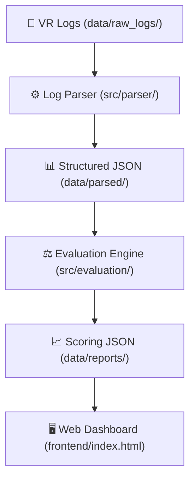

# 🏥 VR Medical Training Evaluation System

An automated evaluation system designed for medical VR training scenarios, focusing on the ABCDE emergency scheme for postoperative complications.

## 🏗️ System Architecture

This project is divided into three major components:

1. **Parser (Person A):** Converts raw `.txt` and `.docx` VR logs into structured JSON event timelines.
2. **Evaluation Engine (Person B):** Applies medical rubrics (ABCDE protocol + time constraints) to the structured timelines to generate scores and feedback.
3. **Web Dashboard (Person C):** A visual front-end that loads the Evaluation output and displays the finalized report to the medical instructor.



## 📂 Project Structure

```text
vr-training-evaluator/
├── README.md                 <-- You are here
├── data/
│   ├── raw_logs/             <-- Put original VR logs (.txt, .docx) here
│   ├── parsed/               <-- Output from Parser goes here (.json)
│   └── reports/              <-- Output from Evaluation Engine goes here (.json)
├── frontend/
│   ├── index.html            <-- Dashboard entry point
│   ├── styles.css            <-- UI styling
│   └── script.js             <-- UI logic for loading the reports
└── src/
    ├── parser/
    │   ├── log_parser.py     <-- Parses txt files
    │   └── docx_parser.py    <-- Parses docx files + extracts expert comments
    └── evaluation/
        └── engine.py         <-- Medical assessment logic based on ABCDE
```

## 🚀 Workflows

### Person A Workflow (Parser)
1. Add new log files to `data/raw_logs/`
2. Run `python src/parser/docx_parser.py`
3. Verify JSON output in `data/parsed/`

### Person B Workflow (Evaluation)
1. Read JSON array from `data/parsed/`
2. Run evaluation rules in `src/evaluation/engine.py`
3. Output the final graded report to `data/reports/report_X.json`

### Person C Workflow (Dashboard)
1. Write dashboard logic in `/frontend/` 
2. Use Javascript's `fetch()` to dynamically read `data/reports/report_X.json`
3. Display the final score and critical warnings in the UI.
